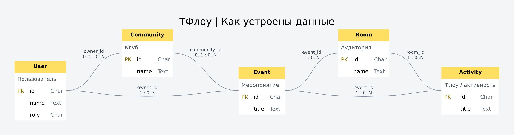

# ER-схемы ТФлоу

Начните с обзора, затем откройте нужный тематический лист. PNG удобно вставлять в презентацию; SVG можно увеличивать без потери качества. Английские имена совпадают с классами в `backend/flow/models.py`, русские подписи поясняют назначение.

| Лист | Картинка | Вектор | Что показывает |
|---|---|---|---|
| 1 | [Обзор](01-overview.png) | [SVG](01-overview.svg) | Пользователь → клуб → мероприятие → аудитория → флоу |
| 2 | [Программа](02-program.png) | [SVG](02-program.svg) | Поля события, аудитории и активности |
| 3 | [Записи и очереди](03-registration.png) | [SVG](03-registration.svg) | Билет мероприятия, запись на флоу и две очереди |
| 4 | [Посещение и вебинары](04-attendance.png) | [SVG](04-attendance.svg) | Отметки входа, посещение флоу, онлайн-комнаты |
| 5 | [Ключи доступа](05-permissions.png) | [SVG](05-permissions.svg) | Помощники сканера, ведущие флоу, использование ключей |
| 6 | [Клубы](06-community.png) | [SVG](06-community.svg) | Членство, подписка, фото клуба и избранное |
| 7 | [Уведомления](07-notifications.png) | [SVG](07-notifications.svg) | Сообщения, напоминания и служебные модели |
| 8 | [Аккаунт](08-user.png) | [SVG](08-user.svg) | Все поля пользователя и профиля |



## Как читать

- Карточка - таблица. Строка - колонка. Типы показаны в терминах Django ORM; SQL-тип зависит от SQLite/PostgreSQL.
- `PK` - первичный ключ, однозначно определяющий строку.
- `FK` - внешний ключ: ссылка на другую таблицу. Например, `Activity.event_id` хранит id мероприятия.
- `UQ` - уникальное значение одного поля. Составные и условные уникальные ограничения перечислены в [словаре данных](data-dictionary.md).
- `NULL` - ссылка или значение может отсутствовать. Отсутствие NULL не запрещает пустую строку.
- Линия идёт от родительской таблицы слева к таблице с FK справа. Над линией имя колонки и пара `родитель : потомки`. `1 : 0..N` означает: у дочерней строки ровно один родитель, у родителя может быть от нуля до многих дочерних строк. `0..1 : 0..N` разрешает дочерней строке обходиться без родителя. `1 : 0..1` - необязательная отдельная запись один-к-одному, например фото пользователя.
- Карточка «ссылка» повторяет уже существующую таблицу и показывает только PK, чтобы не перегружать лист. Это не новая таблица. На обзоре поля сокращены, а FK указаны на линиях; на тематических листах у каждой модели есть полная карточка.

## Важные различия

`EventRegistration` - билет на мероприятие. `Registration` - запись на определённый флоу. `CheckIn` и `ActivityAttendance` - фактическое посещение. Запись сама по себе не означает, что человек пришёл.

`Membership` связывает пользователя с клубом; `notify_events` включает уведомления о новых событиях. Членство не записывает автоматически на мероприятия.

`EventAccessKey` хранит хеш ключа. `scan` относится ко всему мероприятию, а `webinar` - к конкретной активности. Отозванные ключи остаются для истории. Условная уникальность не позволяет иметь несколько неотозванных ключей одного охвата; истечение срока проверяет приложение.

`Webinar.activity` допускает NULL: это общая комната мероприятия. Непустая ссылка указывает на отдельный флоу. UUID `Webinar.room` - идентификатор комнаты LiveKit, а не FK на аудиторию `Room`.

Почтовой таблицы больше нет: миграция `0028_delete_notificationemail` удаляет старую очередь писем. `Notification` остаётся центром уведомлений на сайте.

Стандартные внутренние таблицы Django и унаследованные M:N-права описаны в словаре отдельно. Проверки расписания, прав, вместимости и совпадения мероприятия у связанных объектов выполняются также кодом приложения; ER не подменяет бизнес-правила.

## Обновление после изменения моделей

Из папки `tflow` (для отрисовки нужен Node и шрифт DejaVu Sans):

```sh
.venv/bin/python scripts/generate-er.py
npm install --prefix /tmp/tflow-er-tools @viz-js/viz@3.25.0 @resvg/resvg-js@2.6.2
node scripts/render-er.mjs /tmp/tflow-er-tools
```

Генератор читает метаданные моделей, а не персональные данные базы; миграции не применяет. Проверяет, что каждая доменная модель имеет полную карточку. DOT - редактируемые исходники графов. Инструменты отрисовки устанавливаются отдельно от зависимостей сайта: [Viz.js](https://viz-js.com/api/), [Graphviz HTML labels](https://graphviz.org/doc/info/shapes.html).
